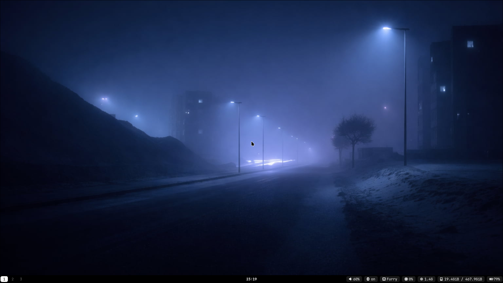
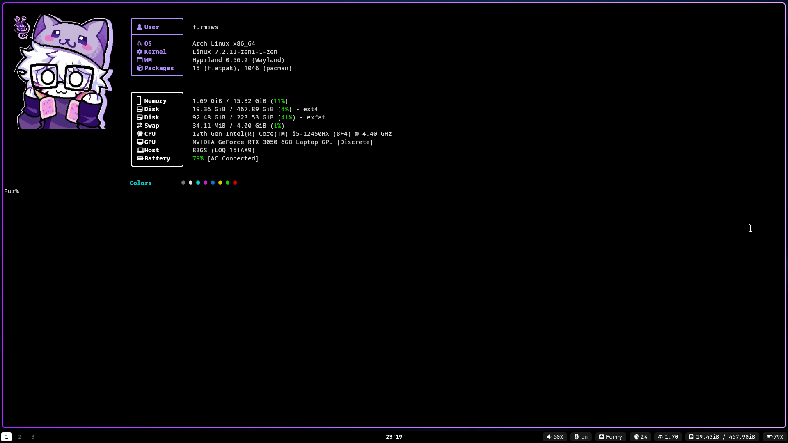
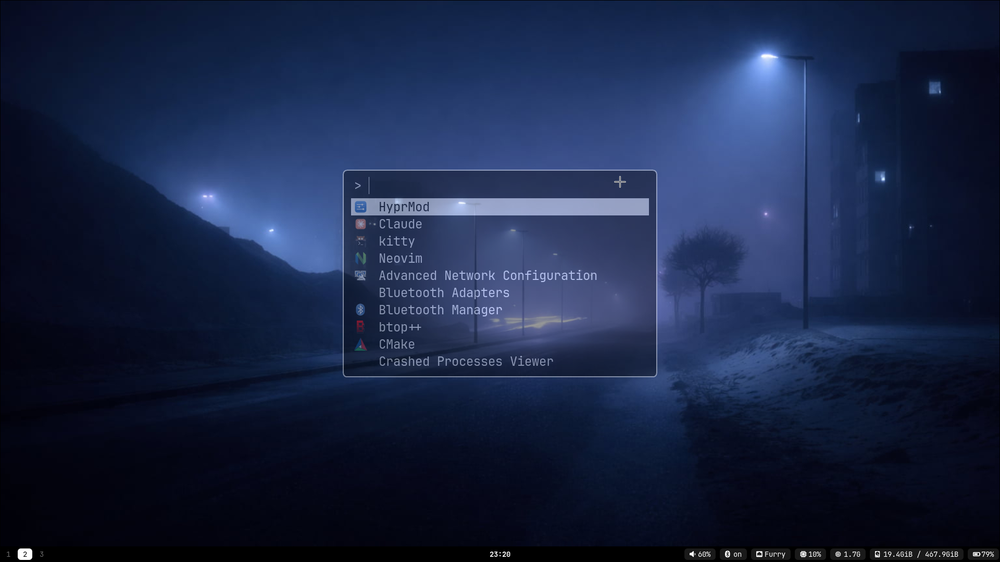
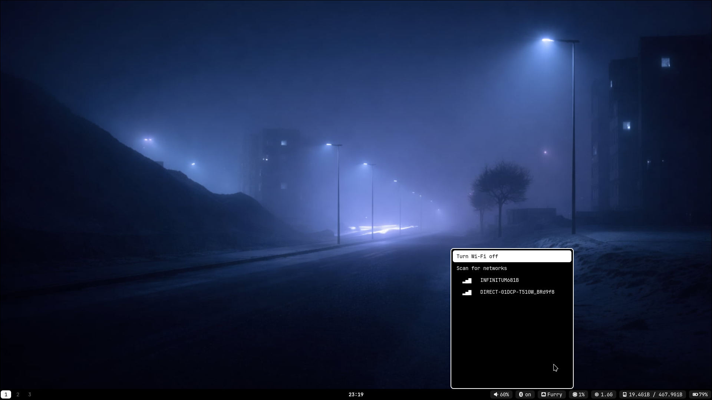
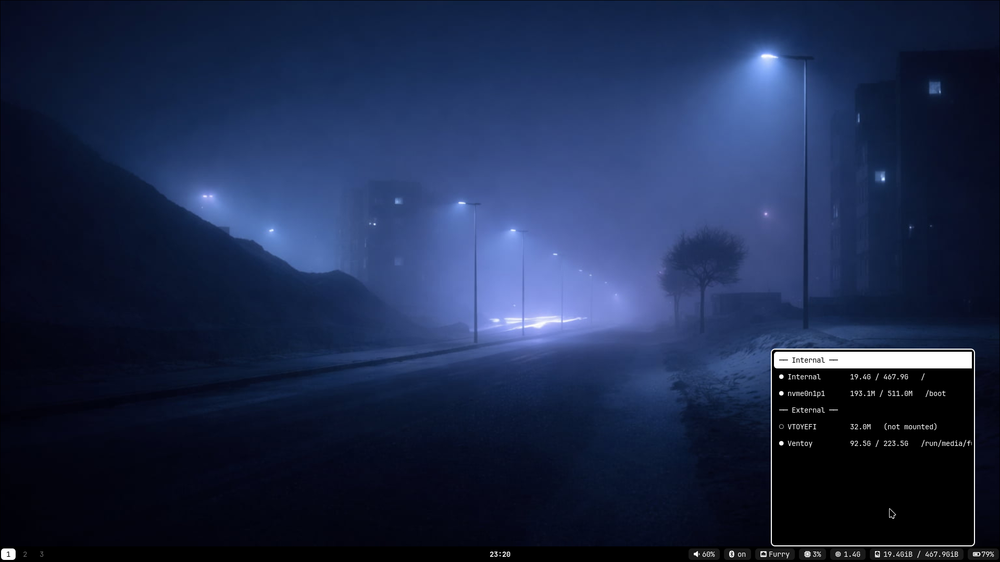
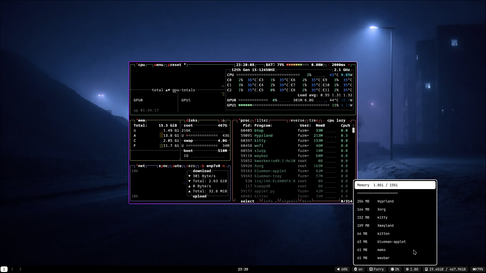
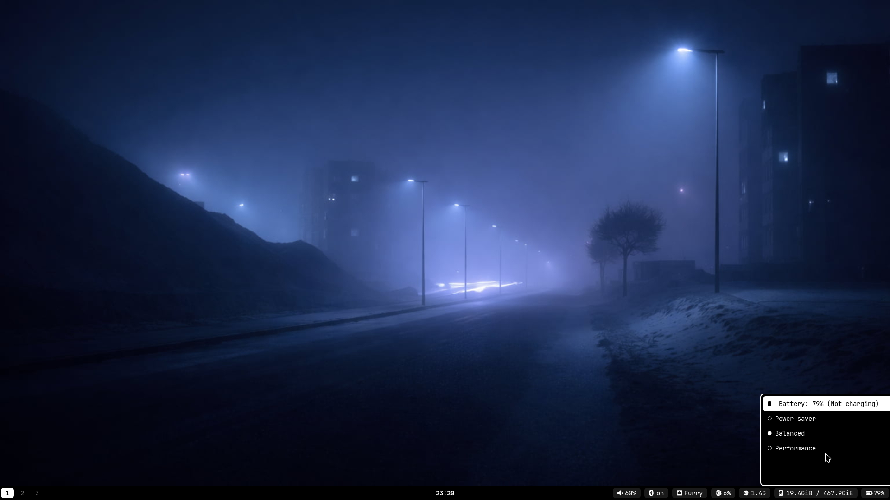

# Hyprland black & white setup

> This is my **new and best** Hyprland config! I made a [first one](https://github.com/furmiws/Hyprconfs) and... it wasn't great, lol. This one is a full rewrite: black and white, a Waybar with popups, and a one-command installer.

A minimal black and white Hyprland desktop: Waybar with popups, Fuzzel, Mako, Wofi menus and a custom Fastfetch.

## Screenshots

| | |
|---|---|
|  |  |
|  |  |
|  |  |

## What's included

- **Waybar** (bottom bar): workspaces 1-3, music title and controls, clock popup with calendar, volume, Bluetooth, Wi-Fi, CPU, RAM, storage and battery popups, and a power menu
- **Fuzzel** app launcher (SUPER + D)
- **Mako** notifications
- **Wofi** styling for the popups
- **Fastfetch** with a custom logo
- **Hyprlock and Hypridle**: black lock screen (SUPER + L, or the power menu), locks after 5 minutes idle
- Black window borders

## Requirements

- Arch Linux (or Arch-based) with pacman. Fedora and NixOS are supported too, but **untested** (see below) [I will add support for other Linux distributions when I have the time and tried them]
- Hyprland 0.55+ using the Lua config (`~/.config/hypr/hyprland.lua`)
- Working audio (PipeWire)

## Install

    git clone https://github.com/furmiws/hypr-dotfiles.git
    cd hypr-dotfiles
    ./install.sh

Existing configs are backed up as `*.bak-<date>` before anything is replaced.

## Notes

- The installer offers `waybar-git` from the AUR because the packaged Waybar can't click workspaces on Hyprland 0.55 Lua configs.
- On machines without a battery, the battery module is removed automatically.
- The Wi-Fi, Bluetooth, RAM and storage popups are positioned by guesswork. If one is off, change the `XOFF` value at the top of its script in `~/.config/waybar/`.
- Replace `config/fastfetch/logo.png` with your own image if you like.

## Wallpaper

The wallpaper isn't included (it isn't mine to share). I use [this one](https://www.wallpaperflare.com/ambient-dark-snow-fog-night-wallpaper-ykgif/download). Download it and save it as `~/.config/wallpaper/wallpaper.png`.

## Customizing

Everything lives in plain text files under `~/.config/`, so you can change it with any editor. Edit the copy in `~/.config/`, not the one in this repo, and see the result right away.

### Colors and fonts

The theme is black and white, using these hex colors: background `#000000`, text `#ffffff`, buttons `#1a1a1a`, dimmed text `#6b6b6b`.

| What | File |
|---|---|
| Bar colors and font | `~/.config/waybar/style.css` |
| Popup menus (Wi-Fi, Bluetooth, battery, RAM, storage, power) | `~/.config/waybar/dmenu.sh` (the long `common=(...)` line holds the colors, font and size) |
| App launcher (SUPER + D) | `~/.config/fuzzel/fuzzel.ini` |
| Notifications | `~/.config/mako/config` |
| Fastfetch colors and layout | `~/.config/fastfetch/config.jsonc` |

The font is **JetBrainsMono Nerd Font** everywhere. To switch, change the font name in those files. Use a Nerd Font, or the icons will show as empty boxes.

### Bar layout

Open `~/.config/waybar/config.jsonc`:

- `modules-left`, `modules-center` and `modules-right` list what's on the bar. Delete a name to remove a module, or reorder them.
- `persistent-workspaces` sets which workspaces are always shown (default `[1, 2, 3]`).
- The music title and buttons only appear while a player is open.

### Popup positions and size

- **Menus** (Wi-Fi, Bluetooth, RAM, storage): change the `XOFF` number at the top of the script in `~/.config/waybar/`. A bigger negative number moves it further left.
- **Menu size**: in `dmenu.sh`, change `size=9` (font) and the `--horizontal-pad` and `--vertical-pad` values.
- **Clock popup**: change the `move = "830 810"` line in `~/.config/hypr/hyprland.lua` (the first number is horizontal, the second vertical, for a 1920x1080 screen).
- **Notifications**: `anchor`, `width` and `height` in the Mako config.

### Wallpaper, launcher key and logo

- **Wallpaper**: put your image at `~/.config/wallpaper/wallpaper.png`. The fit mode (`-m fill`) is in `hyprland.lua`; other modes are `fit`, `center`, `stretch` and `tile`.
- **Launcher key**: the `SUPER + D` line in `hyprland.lua`.
- **Fastfetch logo**: replace `~/.config/fastfetch/logo.png`.

### Applying changes

| Changed | Run |
|---|---|
| Bar style (`style.css`) | nothing, it reloads by itself |
| Bar config or scripts | `killall waybar; waybar &` |
| Notifications | `makoctl reload` |
| Hyprland config | `hyprctl reload` |

### Troubleshooting

- **Icons show as empty boxes**: the Nerd Font isn't installed or isn't picked up. Check with `fc-list | grep -i jetbrains`.
- **The bar doesn't appear**: run `waybar` in a terminal (without `&`) and read the error.
- **A popup shows nothing or fails**: check that `fuzzel` is installed, and run the script from a terminal, for example `~/.config/waybar/wifi-menu.sh`.
- **Clicking workspaces does nothing**: see the notes above about `waybar-git`.

## Other distros (untested)

I use Arch, so these are best-effort and I haven't been able to test them. Issues and fixes are welcome.

### Fedora

Fedora doesn't ship Hyprland in its official repos, so it comes from a COPR. For example:

    sudo dnf copr enable ashbuk/Hyprland-Fedora
    sudo dnf install hyprland xdg-desktop-portal-hyprland

This setup uses the Lua config, so you need **Hyprland 0.55 or newer** (check with `Hyprland --version`) and a `~/.config/hypr/hyprland.lua` (Hyprland creates one on first run). Then:

    git clone https://github.com/furmiws/hypr-dotfiles.git
    cd hypr-dotfiles
    ./install.sh

The installer uses `dnf` for everything else and downloads the JetBrainsMono Nerd Font. If clicking workspaces doesn't work, Fedora's Waybar may be too old for Lua configs; try the Waybar from the `nett00n/hyprland` COPR.

### NixOS

The installer can't manage packages on NixOS, so install them in your Nix config, then copy the config files with `--configs-only`.

1. Add this to `/etc/nixos/configuration.nix` (adjust to taste) and run `sudo nixos-rebuild switch`:

        { pkgs, ... }: {
          programs.hyprland = { enable = true; withUWSM = true; };

          environment.systemPackages = with pkgs; [
            waybar playerctl kitty fuzzel mako libnotify btop fastfetch swaybg
            blueman python3 git
          ];
          fonts.packages = [ pkgs.nerd-fonts.jetbrains-mono ];

          networking.networkmanager.enable = true;
          hardware.bluetooth.enable = true;
          services.blueman.enable = true;
          services.power-profiles-daemon.enable = true;
          services.udisks2.enable = true;
        }

2. Start Hyprland once so it creates `~/.config/hypr/hyprland.lua`, then:

        git clone https://github.com/furmiws/hypr-dotfiles.git
        cd hypr-dotfiles
        ./install.sh --configs-only

3. If your `hyprland.lua` is managed by Home Manager (a read-only symlink), the installer skips it. Copy the contents of `hypr/setup-block.lua` into your Nix config instead. Home Manager 26.05 and newer can generate Lua configs; see the [NixOS wiki page for Hyprland](https://wiki.nixos.org/wiki/Hyprland).

If clicking workspaces doesn't work, your Waybar may not have the fix for Lua configs yet (Waybar PR #5013).
